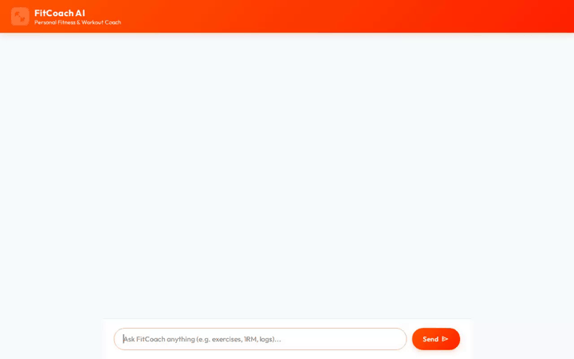

# FitCoach AI — Intelligent Personal Workout Coach



**FitCoach AI** is an intelligent fitness and workout coaching assistant built with the Google Agent Development Kit (ADK) and deployed on Vertex AI Agent Engine. It helps users discover exercises, build workout protocols, log completed sets, calculate performance metrics, and generate visual exercise illustrations and video demonstrations.

---

## Key Features & Capabilities

- **Exercise Discovery & Protocol Building**: Search exercise catalogs and retrieve muscle-specific workouts and form instructions.
- **Workout Logging**: Track completed workout sets, weights, and reps persisted directly to a NoSQL database.
- **1-Rep Max Calculator**: Accurately calculate 1RM metrics using Brzycki or Epley formulas executed dynamically in a secure code sandbox.
- **Visual Exercise Illustrations**: Generate high-quality exercise diagrams using Imagen 3.
- **Exercise Video Demonstrations**: Generate motion video demonstrations of exercises using Google's Omni and Veo video models.
- **Cross-Session Memory**: Remember user preferences, fitness goals, and physical stats across sessions.

---

## Integrated Tools & Google Cloud Services

The following tools and services are fully wired and implemented in the codebase:

### Google Cloud Infrastructure & AI Services
- **Vertex AI Agent Engine (Agent Runtime)**: Hosts the ADK reasoning engine and manages agent lifecycle.
- **Vertex AI Memory Bank Service**: Persists long-term user facts and fitness preferences across conversations.
- **Google Cloud Firestore**: Persists exercise definitions (`exercises` collection) and user workout logs (`workout_logs` collection).
- **Google Cloud Storage (GCS)**: Public media bucket storing generated exercise images and video demonstrations.
- **Vertex AI Imagen 3 (`imagen-3.0-generate-002`)**: Generates custom visual exercise illustrations.
- **Vertex AI Video Models (`gemini-omni-flash-preview` & `veo-3.1-fast-generate-001`)**: Generates video clips demonstrating proper exercise form.

### Agent Tools (`app/agent.py`)
- `search_wger_exercises`: Queries the external Wger REST API for exercise descriptions and muscle groups.
- `get_exercise_details`: Fetches full exercise information from Firestore.
- `log_workout`: Records completed workout sets into Firestore.
- `calculate_one_rep_max`: Computes 1RM metrics in the ADK code execution sandbox.
- `generate_fitness_image`: Generates an image artifact and uploads the public asset to Cloud Storage.
- `generate_fitness_video`: Generates a video demonstration artifact and uploads the public asset to Cloud Storage.

---

## Project Structure

```
fitcoach-ai/
├── app/
│   ├── __init__.py
│   └── agent.py              # Core ADK agent definition and tools
├── frontend/
│   ├── main.py               # FastAPI proxy server for A2A communication
│   └── static/
│       └── index.html        # Custom chat interface
├── agents-cli-manifest.yaml  # Agent CLI project configuration
├── pyproject.toml            # Dependencies and environment definition
├── demo.gif                  # Recorded agent interaction demo
└── README.md
```

---

## Local Setup & Execution Instructions

### Prerequisites
- Python 3.11+
- `uv` package manager (`pip install uv`)
- Google Cloud SDK (`gcloud`) authenticated with a project

### Running the Agent Locally

1. **Install Dependencies**:
   ```bash
   uv sync
   ```

2. **Start the ADK Agent Playground**:
   ```bash
   uv run adk web . --port 8000 --allow_origins "*" --reload_agents
   ```

3. **Start the Custom Chat Frontend**:
   ```bash
   cd frontend
   uv run python main.py
   ```

4. **Deploy to Agent Engine**:
   ```bash
   agents-cli deploy --no-confirm-project
   ```
